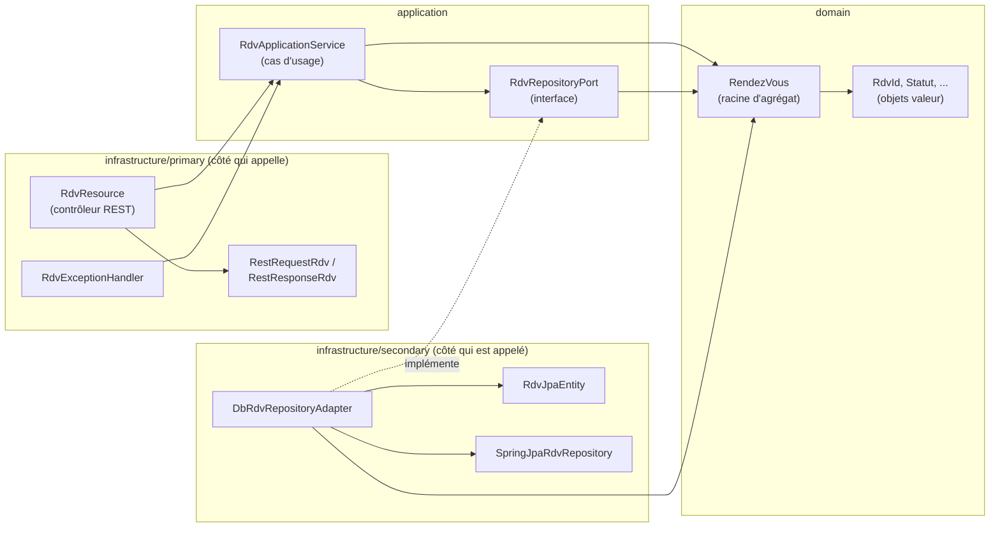
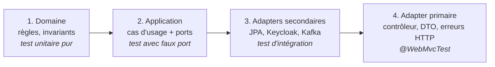
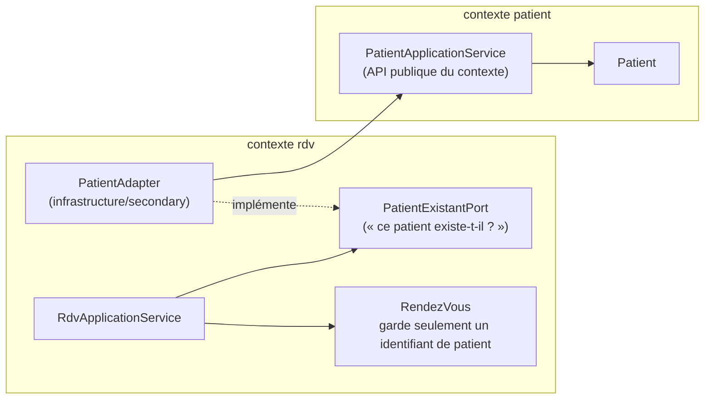
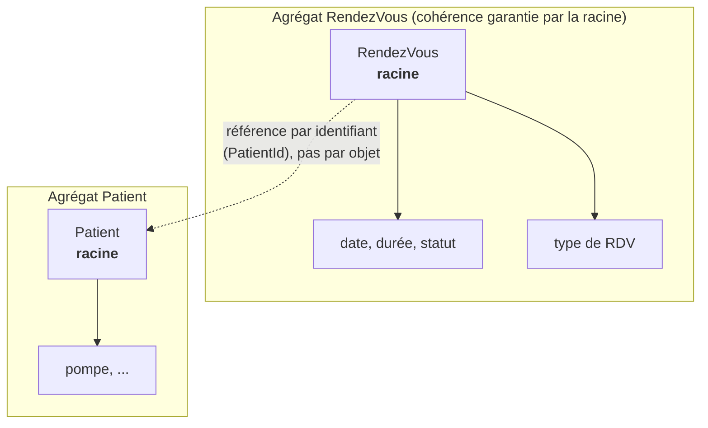

# Architecture hexagonale de diabcare : schémas

Les noms de packages reprennent ceux du dépôt (`patient/domain`, `application`, `infrastructure/primary`, `infrastructure/secondary`).

## 1. Sens des dépendances dans un contexte (exemple : `rdv`)

Une flèche « A → B » signifie « A connaît B » (A importe des classes de B).
La règle : **tout pointe vers le domaine, rien ne sort du domaine**.

Points à retenir :
- `domain` n'importe **rien** d'autre que du Java (ni Spring, ni JPA, ni Jackson).
- `application` connaît le domaine, et définit les **ports** (interfaces) dont il a besoin.
- Les adapters connaissent les ports et le domaine. **Jamais l'inverse.**
- L'entité JPA et les DTO REST sont distincts de l'agrégat : l'adapter convertit dans les deux sens.

## 2. Ordre d'implémentation d'un endpoint

On construit du centre vers l'extérieur : chaque étape ne s'appuie que sur ce qui existe déjà.

## 3. Entre deux contextes : on passe par un port, pas par le domaine de l'autre

Le contexte `rdv` a besoin de savoir si un patient existe, mais il ne doit pas importer `Patient` ni son domaine.
Il **définit son propre port**, formulé dans son vocabulaire. Un adapter de `rdv` le réalise en appelant l'API applicative de `patient`.

Points à retenir :
- `RendezVous` référence le patient par son **identifiant** (un `PatientId` ou un simple identifiant), jamais par un objet `Patient`.
- Le seul code de `rdv` qui connaît `patient` est l'adapter. Si `patient` change, un seul fichier bouge.
- Quand les deux contextes seront séparés plus tard (ou communiqueront par Kafka), seul l'adapter change.

## 4. Agrégat : où passe la frontière ?

