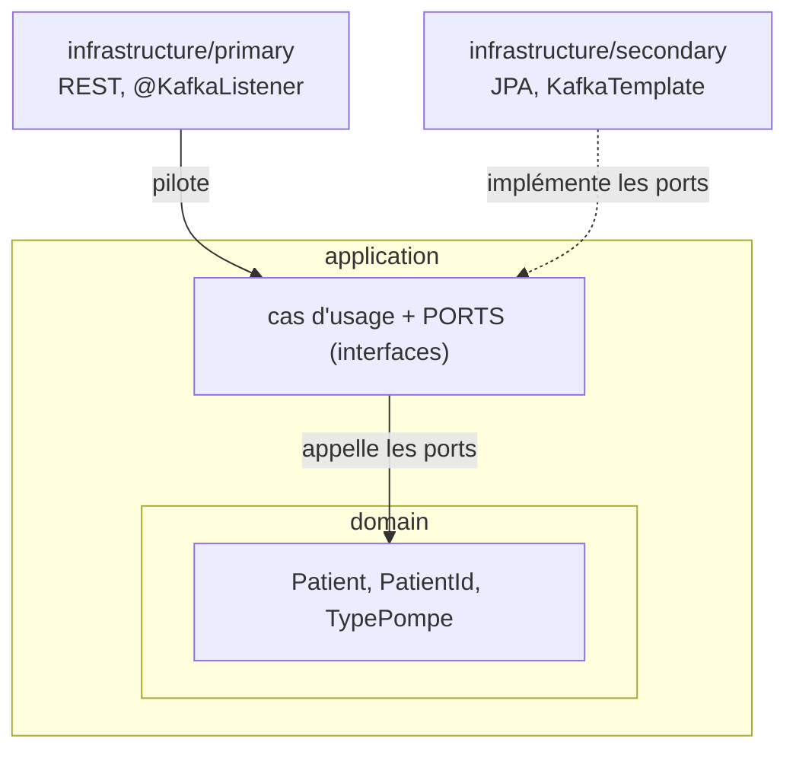

# 0006 — Frontières domaine / application / infra et placement de `@Transactional`

## Contexte

`@Transactional` était posé sur `PatientResource.createPatient` (le controller). Question sous-jacente :
en hexagonal le domaine ne doit pas connaître Spring — où est la frontière exacte, et a-t-on le
droit de mettre du Spring dans l'`applicationService` ?

## Décision

- `@Transactional` **retiré du controller**, posé sur le cas d'usage `PatientApplicationService.save`.
- Spring **autorisé dans la couche `application`**, mais uniquement sous forme d'annotations
  déclaratives (`@Service`, `@Transactional`), jamais d'API Spring appelée dans le corps des méthodes.

```java
@Service
public class PatientApplicationService {

    private final PatientRepositoryPort repository;

    public PatientApplicationService(PatientRepositoryPort repository) {
        this.repository = repository;
    }

    @Transactional
    public void save(Patient patient) {
        repository.save(patient);
    }
}
```

## Pourquoi

### `@Transactional` n'appartient pas au controller

L'annotation n'exprime pas « je suis appelé en HTTP », elle exprime **« cette opération métier est
une unité atomique de travail »**. C'est une propriété du *cas d'usage*, pas du canal d'entrée.

Sur le controller, la transaction n'existe que via REST. Dès qu'un `@KafkaListener` (US8/US10), un
batch ou un test appellera le même cas d'usage, il n'y aura plus de transaction. Sur le cas d'usage,
**tous les points d'entrée en héritent**.

Accessoirement : `open-in-view: false` dans la config → la frontière transactionnelle *doit* être
franchie côté service, sinon les accès JPA hors transaction cassent.

### Les couches et où Spring a le droit d'être



| Couche | Spring / JPA / Jackson ? | Vérifié par |
|---|---|---|
| `domain` | **interdit** (`org.springframework.*`, `jakarta.persistence.*`) | ArchUnit US12.1 |
| `application` | annotations déclaratives tolérées (`@Service`, `@Transactional`, `@Component`) | — |
| `infrastructure.*` | tout permis | ArchUnit US12.2/12.3 pour les dépendances inter-couches |

**La frontière, ce sont les ports.** L'interface `PatientRepositoryPort` est possédée par
`application` ; l'implémentation `DbPatientRepositoryImpl` vit dans `infrastructure.secondary`.
L'inversion de dépendance *est* la frontière. Le domaine (`Patient`) ne référence même pas le port.

### `@Transactional` dans `application` : oui, avec discipline

Deux écoles :

- **Puriste** — `application` aussi sans framework ; transaction via un port dédié
  (`interface UnitOfWork { <T> T inTransaction(Supplier<T> work); }`) implémenté dans `secondary`.
  Portable à 100 %, testable sans contexte Spring.
- **Pragmatique (retenu ici)** — `@Service` + `@Transactional` tolérés dans `application`. C'est
  l'idiome Spring dominant ; les annotations n'introduisent aucun type Spring dans les signatures ;
  on peut arracher Spring en supprimant des annotations. Le coût d'un port transactionnel maison ne
  se justifie pas à cette échelle.

Règle : `@Transactional` doit rester **une annotation, pas une dépendance**.

| ✅ OK dans `application` | ❌ Pas dans `application` |
|---|---|
| `@Service`, `@Transactional`, `@Component` | `@Autowired PlatformTransactionManager` |
| | `TransactionTemplate` injecté et appelé |
| | `ApplicationContext`, `Environment`, `@Value` métier |
| | un type Spring dans une signature publique |

Signal du projet : les règles ArchUnit US12 n'interdisent Spring que dans `*.domain`, pas dans
`*.application`. La ligne est tracée là volontairement.

## Conséquences

- `PatientApplicationService` porte la transaction et reste le point d'orchestration futur
  (événements de domaine post-commit, appels multi-repositories…).
- `PatientResource` redevient un pur adaptateur : désérialiser, appeler le cas d'usage, mapper la
  réponse (201).
- `@Autowired` sur les constructeurs mono-argument est redondant depuis Spring 4.3 — peut être
  retiré partout (`PatientResource`, `PatientApplicationService`, `DbPatientRepositoryImpl`).
- ArchUnit (US12) formalisera ces règles ; en attendant elles sont tenues « à l'œil ».